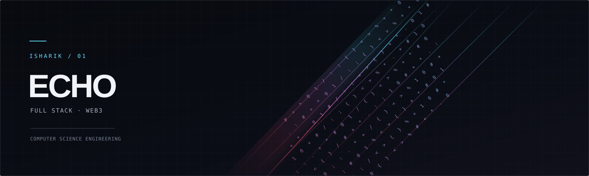

  

  <a href="https://portfolio-isharik.vercel.app/">Portfolio</a> &nbsp;·&nbsp;
  <a href="https://www.linkedin.com/in/sharikhussain1/">LinkedIn</a> &nbsp;·&nbsp;
  <a href="https://github.com/isharik">GitHub</a>

<h1 align="center">Echo he/him</h1>

  <strong>Computer Science Engineering · Full Stack</strong> 
  Building across the stack, with a current focus on projects in the Pharos ecosystem.

---

### Selected work

| Project | Built with | Link |
|:--|:--|:--|
| **Pharos-Octobot** | Python · Pharos | [Repository](https://github.com/isharik/Pharos-Octobot) |
| **Portfolio** | TypeScript | [Live site](https://portfolio-isharik.vercel.app/) |
| **Vortex** | TypeScript | [Repository](https://github.com/isharik/Vortex) |

### Languages

`TypeScript` &nbsp; `Python`

---

  <a href="https://portfolio-isharik.vercel.app/">portfolio-isharik.vercel.app</a> 
  Thanks for visiting. Explore the repositories for more.

